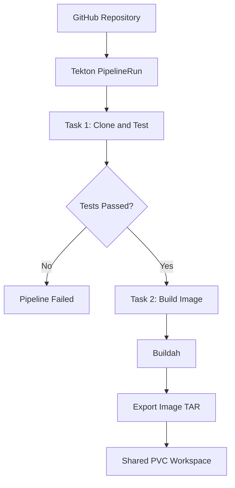

# Konflux CI POC — Tekton Pipeline

A hands-on Proof of Concept (POC) exploring Kubernetes-native CI/CD using **Tekton Pipelines**, **Buildah**, and **Kind**. This project demonstrates automated unit testing, container image building, and artifact export through a multi-task pipeline.

> **Note:** This is an educational POC inspired by Konflux concepts. It is not a production Konflux installation.

## Overview

The pipeline automates the following workflow:

1. Clone the application repository from GitHub.
2. Run Python unit tests.
3. Build a container image using Buildah.
4. Export the image as a TAR archive.

## Architecture



The pipeline uses a shared PersistentVolumeClaim (PVC)-backed workspace so that separate Task Pods can access the same source files and generated artifacts.

## Technology Stack

- **Kubernetes:** Local cluster running with Kind
- **Tekton Pipelines:** Pipeline and Task orchestration
- **Buildah:** Container image building and export
- **Python 3.10:** Application runtime and unit testing
- **Dockerfile:** Container image definition
- **GitHub:** Source code hosting

## Project Structure

```text
konflux-poc/
├── .github/
│   └── workflows/
│       └── ci.yml
├── app/
│   └── app.py
├── pipeline/
│   ├── runner.py
│   └── tekton/
│       ├── test-task.yaml
│       ├── build-image-task.yaml
│       ├── test-pipeline.yaml
│       └── test-pipelinerun.yaml
├── tests/
│   └── test_app.py
├── Dockerfile
├── .gitignore
└── README.md
```

## Prerequisites

Install or configure the following tools:

- Docker
- Kind
- `kubectl`
- Tekton Pipelines installed in your Kind cluster
- Git

The commands below assume a Bash-compatible terminal and that you are running them from the project root.

## Setup

### 1. Clone the repository

```bash
git clone https://github.com/dipakshimpi/konflux-ci-poc.git
cd konflux-ci-poc
```

### 2. Start the Kind cluster

If you have not already created the cluster:

```bash
kind create cluster --name konflux-poc
```

Verify the cluster:

```bash
kubectl cluster-info
kubectl get nodes
```

If your cluster already exists, reuse it instead of creating another one.

### 3. Install Tekton Pipelines

Install Tekton Pipelines using the official installation instructions:

https://tekton.dev/docs/pipelines/install/

Verify the installation:

```bash
kubectl get pods -n tekton-pipelines
```

Wait until the required Tekton components are ready.

## Run the Pipeline

### 1. Apply the Tasks

```bash
kubectl apply -f pipeline/tekton/test-task.yaml
kubectl apply -f pipeline/tekton/build-image-task.yaml
```

### 2. Apply the Pipeline

```bash
kubectl apply -f pipeline/tekton/test-pipeline.yaml
```

### 3. Start a PipelineRun

```bash
kubectl create -f pipeline/tekton/test-pipelinerun.yaml
```

The PipelineRun manifest requests a PVC-backed workspace. Kubernetes provisions the volume using the configured storage class.

### 4. Monitor execution

```bash
kubectl get pipelinerun
kub